# ynabUp

[](https://github.com/N11CE1/ynabUp/actions/workflows/ci.yml)

`ynabUp` syncs transactions from Up Bank into YNAB. It supports one-shot reconciliation runs as well as a long-running webhook server with an in-process safety-net sync loop.



See [HLSD.md](HLSD.md) for the architecture and design reasoning, and [TODO.md](TODO.md) for the current backlog.

## What it does

- syncs mapped Up accounts into mapped YNAB accounts
- creates real linked YNAB transfers between your own tracked accounts
- supports both webhook-driven sync and periodic reconciliation
- persists sync state in SQLite so imports stay idempotent
- exposes `/healthz` so a deployment can distinguish "up" from "up but not syncing successfully"

## Quick start

1. Copy `.env.example` to `.env`.
2. Fill in the required Up and YNAB credentials and account mapping.
3. Run a one-shot sync locally:

   ```sh
   go run .
   ```

4. Or run the long-lived webhook server locally:

   ```sh
   go run . -serve
   ```

## Configuration

Copy `.env.example` to `.env` in the project root and fill in the values below (or set them in the environment directly — `.env` is optional, loaded via [godotenv](https://github.com/joho/godotenv) if present).

| Variable | Required | Description |
|---|---|---|
| `UP_API_TOKEN` | yes | Up personal access token, from the [Up developer portal](https://developer.up.com.au/) |
| `YNAB_BUDGET_ID` | yes | The budget's ID (visible in its YNAB web app URL) |
| `YNAB_API_TOKEN` | yes | A YNAB personal access token (Account Settings → Developer Settings) |
| `UP_ACCOUNT_MAP` | yes | JSON object mapping each Up account ID to the YNAB account ID it syncs into — see below |
| `UP_WEBHOOK_SECRET` | only for `-serve` | The secret returned when registering the Up webhook (see below) |
| `DB_PATH` | no (default `sync.db`) | Path to the SQLite file tracking sync state |
| `PORT` | no (default `8080`) | Port `-serve` listens on |
| `CRON_INTERVAL` | no (default `1h`) | How often the reconciliation pass runs in `-serve` mode, as a Go duration (`30m`, `2h`, ...) |
| `YNAB_SAVINGS_ACCOUNT_IDS` | no | Comma-separated YNAB account IDs that should bump `YNAB_SAVINGS_CATEGORY_ID` when a linked transfer lands in them |
| `YNAB_SAVINGS_CATEGORY_ID` | no | The YNAB category funded by the above |

`UP_ACCOUNT_MAP` is a JSON object of `"<up-account-id>": "<ynab-account-id>"` pairs, e.g.:

```json
{"222e1edc-...": "e478350d-...", "33d9ec07-...": "2112c8b2-..."}
```

Mapping more than one Up account is what makes internal transfers between them (e.g. Spending ↔ Saver) detectable and linkable — see [HLSD.md](HLSD.md) for why that matters. Both IDs are visible via Up's and YNAB's own APIs (`GET /accounts` on each).

## Running locally

### One-shot sync

Run a single incremental reconciliation pass and exit:

```sh
go run .
```

This is useful for testing config changes or running the sync from an external scheduler.

### Webhook server

Run the HTTP server plus the in-process reconciliation loop:

```sh
go run . -serve
```

In this mode the service:
- serves Up webhooks at `/webhooks/up`
- exposes a health endpoint at `/healthz`
- performs a reconciliation pass immediately on startup and then every `CRON_INTERVAL`

## Getting an Up webhook secret

Only needed for `-serve` mode. Register a webhook against your deployed `/webhooks/up` URL:

```sh
curl -X POST https://api.up.com.au/api/v1/webhooks \
  -H "Authorization: Bearer $UP_API_TOKEN" \
  -H "Content-Type: application/json" \
  -d '{"data":{"attributes":{"url":"https://your-domain/webhooks/up"}}}'
```

The response includes a `secretKey` — that's `UP_WEBHOOK_SECRET`.

## Testing

```sh
go test ./...
```

## Deploying with Docker Compose

This repo includes a `Dockerfile` and `docker-compose.yml` for running the service on a VPS.

Typical deploy flow:

```sh
git pull
docker compose up -d --build
```

Notes:
- secrets are supplied via `env_file`
- sync state lives in the named volume `ynabup-data`
- the app listens on `127.0.0.1:8080` in Compose and expects TLS termination / public exposure to happen at a reverse proxy
- the container defaults to `-serve`

## Checking health

If the service is running in `-serve` mode, you can query:

```sh
curl http://127.0.0.1:8080/healthz
```

A healthy response looks like:

```json
{"status":"ok","last_synced_at":"2026-11-21T10:15:00Z"}
```

If no successful reconciliation pass has completed yet, `last_synced_at` may be absent.

## Troubleshooting

### `no .env file found, falling back to existing environment`

Usually harmless in Docker. It means the process did not find a literal `.env` file in the container filesystem and is using environment variables already provided by Compose instead.

### `Done: 0 synced, 0 already synced (skipped), 0 failed`

Usually means there were no new Up transactions to process in that reconciliation run.

### Transfers are not linking correctly

Double-check that:
- both Up accounts are present in `UP_ACCOUNT_MAP`
- each mapped destination account exists in the target YNAB budget
- the app can fetch YNAB accounts successfully at startup

### Webhooks are not syncing transactions

Check that:
- the webhook URL points at your deployed `/webhooks/up` endpoint
- `UP_WEBHOOK_SECRET` matches the `secretKey` returned by Up
- the reverse proxy is forwarding requests to the container on port `8080`
